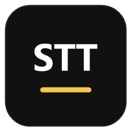
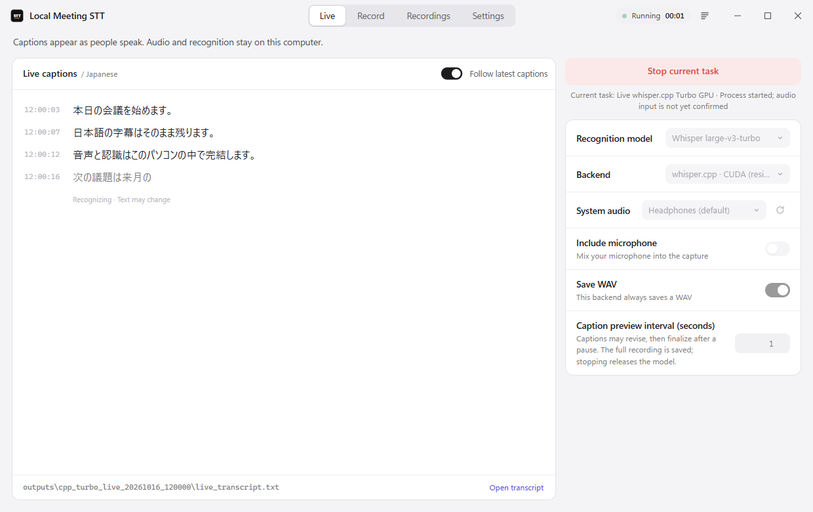

<p align="center">
  
</p>

<h1 align="center">Local Meeting STT</h1>

<p align="center">
  <a href="https://github.com/kuchris/local-meeting-stt/releases/latest"></a>
  <a href="https://github.com/kuchris/local-meeting-stt/stargazers"></a>
  <a href="https://github.com/kuchris/local-meeting-stt/forks"></a>
  <a href="https://github.com/kuchris/local-meeting-stt/issues"></a>
  <a href="LICENSE"></a>
</p>

**English** · [中文](README-ZH.md) · [日本語](README-JA.md)

A Windows desktop app for local meeting captions, audio recording, and
post-meeting transcription. Capture Teams, browser meetings, or other desktop
audio through speaker/headset loopback, with optional microphone mixing.
Recordings and recognition stay on your computer.

**English is the default interface language.** Switch to Traditional Chinese or
Japanese in Settings. The app remembers your choice. Interface language is
separate from recognition language, which can be Chinese (Mandarin), Cantonese,
English, Japanese, or detected for each sentence.



*Current interface with test caption text; this is not a real meeting recording.*

## Get started

The app is a Rust ([Tauri 2](https://tauri.app/)) shell around Python and
whisper.cpp backends. Its window uses the system WebView2, so no browser engine
is bundled. Requirements for running from source:

- Windows 10/11 with the WebView2 runtime (built into Windows 11).
- [Rust](https://rustup.rs/) with the MSVC toolchain, and [uv](https://docs.astral.sh/uv/).
- Local model files and the runtime for your selected backend.
- An NVIDIA GPU for CUDA; other backends have their own hardware requirements.

```powershell
cd desktop\src-tauri
cargo run
```

1. Open **Settings** and check/download the files you need.
2. On **Live**, select a model, a backend and your system audio source.
3. Optionally turn on **Include microphone** and select the microphone.
4. Select **Start meeting**; the same button stops the task. The title bar shows
   the task's status and elapsed time on every page.

A fresh configuration uses SenseVoice-Small on CPU. On a compatible NVIDIA
system, select its CUDA backend or Whisper large-v3-turbo; download either in
Settings & models first.

The first setup may download dependencies and model files. Once installed,
recognition uses local models rather than a cloud ASR service. A running process
is not proof that audio is arriving; check the transcript and process log.

[Portable releases](https://github.com/kuchris/local-meeting-stt/releases) are also
available. Published packages up to v0.3.0 are the earlier Electron app. The root
`open_desktop_app.cmd` launcher opens a release build when present and otherwise
builds and runs your current checkout.

The earlier Electron + React version is kept on the
[`electron` branch](https://github.com/kuchris/local-meeting-stt/tree/electron). Both use the same backends and `settings.json`.

## Pages

| Page | What it does |
| --- | --- |
| Live | Large live transcript beside the model, backend, audio and WAV controls. |
| Record | Save audio for later transcription, with an optional duration limit. |
| Recordings | Choose a recording or drop an audio file anywhere in the window, then select a model and backend. A recording's existing transcripts open in one click. |
| Settings | Appearance, language and output folder; inspect/download models and runtimes. |

The live model choices are **Whisper large-v3-turbo** (CUDA) and
**SenseVoice-Small** (CPU or CUDA). Post-meeting
transcription offers **Whisper small**, **Qwen3-ASR 0.6B**, and the optional, more
accurate **Qwen3-ASR 1.7B**. Qwen is currently a
file-transcription option, not a live-caption backend.

Choose the **recognition language** (Auto-detect, Chinese, Cantonese, English,
Japanese) on the Live and Recordings pages. Live captions in Chinese and
Cantonese are shown in Traditional (HK) characters, or Simplified if chosen
under **Chinese characters** in Settings; SenseVoice itself writes Simplified.
Japanese sessions, and captions with kana, are left as recognized. Vulkan file
transcription still recognizes Japanese only.

Replaying 12 pinned FLEURS clips per language through the live pipeline on an
RTX 5070 Ti, SenseVoice-Small was more accurate for Mandarin (6.6% vs 8.8% CER)
and Cantonese (3.0% vs 6.2–7.7%), and Whisper large-v3-turbo for Japanese (5.4% vs
7.7–8.6%) and English (4.2% vs 7.6–8.0% WER). This is clean read speech, not
meetings, and FLEURS Cantonese is read written Chinese, not colloquial Cantonese.

The selected post-transcription backend is saved. Switching between Whisper and
Qwen preserves CPU/CUDA preference. When no post preference exists, an existing
CUDA live configuration initializes transcription to CUDA; other configurations
start on CPU. An explicit saved CPU choice is preserved.

## Backends and local assets

| Backend | Local files | Notes |
| --- | --- | --- |
| SenseVoice-Small CPU | `models/SenseVoiceSmall/` | Default live captions on CPU through sherpa-onnx (int8, about 230 MB); optional WAV. |
| SenseVoice-Small CUDA | `models/SenseVoiceSmall-fp32/` | Optional live captions on an NVIDIA GPU (fp32, about 900 MB). The first run downloads NVIDIA's CUDA 12 / cuDNN 9 pip packages (about 1.5 GB). |
| whisper.cpp CPU | `whisper_cpp/bin_cpu/Release/` + `ggml-small.bin` | File transcription. |
| whisper.cpp CUDA | `whisper_cpp/bin_cuda/Release/` + `ggml-small.bin` | NVIDIA GPU; file transcription. |
| whisper.cpp CUDA Turbo | `whisper_cpp/bin_cuda/Release/` + `ggml-large-v3-turbo.bin` | Optional NVIDIA live captions; model download is pinned and SHA-256 checked. |
| whisper.cpp Vulkan | `whisper_cpp/bin_vulkan/Release/` + `ggml-small.bin` | File transcription. |
| OpenVINO NPU/GPU | `whisper_cpp/bin_openvino/Release/` + small model and encoder XML/BIN | Requires a compatible OpenVINO device and local build. |
| Qwen CPU/CUDA | `models/Qwen3-ASR-0.6B/` | File transcription; shared pinned Python runtime. |
| Qwen 1.7B CPU/CUDA | `models/Qwen3-ASR-1.7B/` | Optional 4.4 GB download from its row in Settings; more accurate, uses more GPU memory. Same runtime as Qwen 0.6B. |

The `ggml-*.bin` files belong in `whisper_cpp/models/`. Turbo live captions need
`whisper-server.exe` as well as `whisper-cli.exe`. Asset checks verify paths, not
hardware compatibility or the integrity of every downloaded file. Vulkan and
OpenVINO runtimes are local/release artifacts rather than normal model downloads.

## Latency and stopping

Live sessions keep one model loaded for the meeting (a whisper.cpp server for Turbo).
Silero VAD finds utterance boundaries. The unfinished utterance is re-transcribed
every 0.3 s (SenseVoice) or 0.5 s (Turbo) from 0.1 s capture blocks, and appears as
the last transcript line, typed out as it grows; a revision rewrites the characters
in place. A pause triggers a final pass, which replaces that line. Capture keeps
all arriving audio even when inference is busy; stale previews may be skipped while
completed utterances and WAV recording continue. The model is released at session end.
Capture keeps a 0.5 s WASAPI buffer (soundcard's default is about 10 ms, which
dropped audio whenever the capture thread ran late) and resamples blocks as one
continuous signal, so the WAV has no gaps or block seams.

Replaying 40 s of continuous Cantonese through the app (SenseVoice on CPU), the
line changed every 0.1–0.2 s instead of once a second. The live loop's update lag
stayed at p95 0.13 s, or 0.35 s with six CPU cores busy. A preview waits for
0.6 s (SenseVoice) or 0.8 s (Turbo) of speech and must be in the chosen language's
script: replaying 4 clips per language, previews that disagreed with the final
text fell from 8.3% to 0.9% for Turbo and from 2.3% to 0.8% for SenseVoice.

Python live/record jobs get up to 10 seconds to stop capture, close their WAV,
and release the model worker. If they do not exit, the app terminates the process
tree. File transcription jobs use forced termination.
Closing the app also waits for cleanup. Stopping may omit queued/partial captions
or interrupt unfinished output; use the saved recording for final transcription.

Qwen launchers share `python_backend/qwen-requirements.txt`, including
PyTorch 2.11 / CUDA 12.8 for compatible NVIDIA GPUs such as the RTX 5070 Ti.
The CPU option uses the same runtime with CPU inference. A GPU kernel check runs
before loading weights, and missing local models produce an explicit error.

See [backend diagnosis and measured checks](docs/backend-review.md). Public-file
replays and native checks of the earlier Electron app have passed, as have this
app's file transcription, stop and close-while-running checks; they do not
establish accuracy or capture reliability in a real meeting.

## Saved files and controls

Outputs default to `outputs/`. A live session typically contains:

```text
outputs/
  live_meeting_YYYYMMDD_HHMMSS/
    audio.wav
    live_transcript.txt
```

Folder prefixes vary by backend. Post-transcription of a session's `audio.wav`
writes the transcript into that session folder. Other imported audio writes its
transcript to the configured output folder.

- **Ctrl+O**: choose audio for transcription.
- **Ctrl+1** to **Ctrl+4**: switch pages.
- **Ctrl+L**: show or hide the process log (also the log button in the title bar).
- **Esc**: close the process log.

`settings.json` stores the display language (`ui.locale`), theme (`ui.theme`), post backend
(`post.kind`), capture devices, live mode, and output preferences. Saved language
choices are retained when upgrading; missing/invalid language settings use English.
Raw backend logs, device names, filenames, and transcript text are not translated.

## Build and verification

```powershell
cd desktop\src-tauri
cargo test
cargo clippy --all-targets
```

See [desktop development and test instructions](desktop/README.md) for the
caption parity fixture, the audio-device check and the source layout.

To build a folder-style portable app, run `build_portable_folder.cmd` from the
repository root. Each build creates a fresh `desktop/dist/release-VERSION-ID/`
directory with a portable folder, versioned ZIP, and `SHA256SUMS.txt`. The package
contains the executable, backend scripts, clean English settings, and available
Vulkan/OpenVINO runtimes. Models, Python environments, caches, and recordings are
excluded. CPU/CUDA runtimes can be downloaded in Settings.

Download packaged builds from [Releases](https://github.com/kuchris/local-meeting-stt/releases/latest).
Extract the whole ZIP into a writable folder and run `Local Meeting STT.exe`;
keep the backend folders beside it. Install
[uv](https://docs.astral.sh/uv/getting-started/installation/) on PATH first.
The window needs the WebView2 runtime, which Windows 11 includes. First use requires internet to
install Python dependencies and download models. Extract upgrades into a separate
folder, then copy your models and recordings as needed. Windows builds are unsigned.

For command-line workflows and the backend directory layout, see
[TECHNICAL.md](TECHNICAL.md).

## ASR experiments

The separate [benchmark tools](benchmarks/README.md) compare Japanese accuracy
and latency without changing the app's model selection:

- [Whisper/Qwen measured results](docs/asr-benchmark/2026-09-22/REPORT.zh-TW.md).
- [Nemotron 3.5 streaming follow-up](docs/asr-benchmark/2026-09-22-nemotron/REPORT.zh-TW.md).
- [Whisper live-caption replay](docs/asr-benchmark/2026-09-23-live-whisper/REPORT.zh-TW.md).

These are small clean-speech experiments, not meeting-quality guarantees.
Models, downloaded audio, private recordings, caches, and runtime environments
are excluded from Git.

## License

Apache-2.0. See [LICENSE](LICENSE).

## Support

If this project is useful, a GitHub star helps others find it.

[](https://www.star-history.com/#kuchris/local-meeting-stt&Date)
